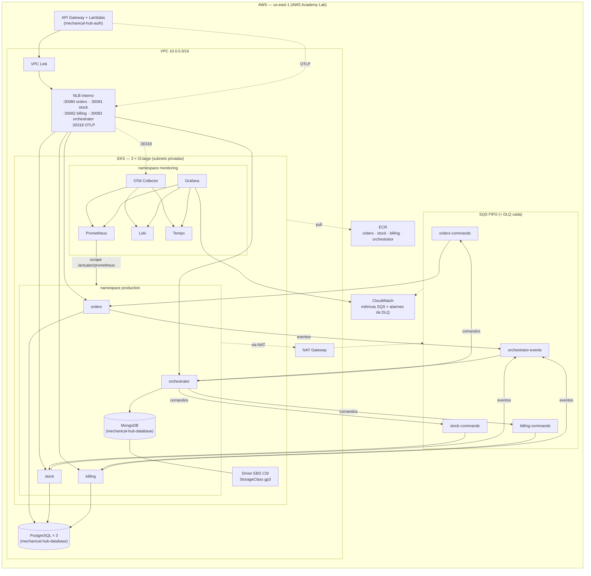

# mechanical-hub-infra

Infraestrutura base da plataforma Mechanical Hub: rede (VPC), cluster de
execução (EKS), registro de imagens (ECR), filas da saga (SQS), NLB interno e a
stack de observabilidade.

Este é o primeiro repositório a ser aplicado. Os demais leem os outputs daqui
via `terraform_remote_state`, conforme a ADR-0004.

## Escopo da Fase 4

Na Fase 4 o monolito `mechanical-hub` foi dividido em quatro serviços
(ADR-0005) que conversam por uma saga orquestrada sobre filas SQS FIFO
(ADR-0006). Para este repositório isso significou:

| Componente | Fase 3 | Fase 4 |
| --- | --- | --- |
| ECR | 1 repositório `mechanical-hub/api` | 1 repositório por serviço: `mechanical-hub/orders`, `/stock`, `/billing`, `/orchestrator` |
| NLB interno | 1 target group + listener na NodePort 30080 | 1 target group + listener por serviço; OTLP 30318 mantido |
| EKS | 3 × `t3.medium` | 3 × `t3.large`, IMDSv2 com hop limit 2 (launch template) |
| Driver EBS CSI | Opcional, dentro da observabilidade, desligado | Ligado por padrão no módulo `eks`, com StorageClass `gp3` (`WaitForFirstConsumer`) |
| Mensageria | — | Módulo `sqs`: 4 filas FIFO + 4 DLQs, alarme por DLQ |
| Observabilidade | Painéis do monolito | Scrape dos 4 serviços, painel por serviço + painel da saga, fonte CloudWatch, alertas de DLQ e outbox |

| Dentro deste repositório | Fora |
| --- | --- |
| VPC, subnets, NAT, route tables | Bancos (PostgreSQL e MongoDB) → `mechanical-hub-database` |
| Cluster EKS, node group, driver EBS CSI e StorageClass | API Gateway e Lambdas → `mechanical-hub-auth` |
| Repositórios ECR dos 4 serviços | Manifestos dos serviços → repositório de cada serviço |
| Filas SQS FIFO e DLQs | Instrumentação do código → repositório de cada serviço |
| NLB interno (um listener por serviço) | |
| Stack de observabilidade (RFC-0004) | |

**Fora do escopo por enquanto:** VPC endpoint para o SQS (cobra por hora; o
tráfego vai pelo NAT existente) e ingress controller (o AWS Load Balancer
Controller exige IRSA, bloqueado no Lab).

## 🛠️ Tecnologias

| Camada | Tecnologia |
|---|---|
| IaC | Terraform >= 1.7 (`terraform test`), provider AWS ~> 5.0 |
| Rede | Amazon VPC, subnets públicas/privadas, NAT Gateway |
| Orquestração | Amazon EKS 1.33, node group gerenciado (3 × t3.large), add-on `aws-ebs-csi-driver` |
| Mensageria | Amazon SQS FIFO com DLQ nativa (redrive policy) |
| Registro de imagens | Amazon ECR |
| Load Balancing | Network Load Balancer interno (provisionado direto via Terraform, sem AWS Load Balancer Controller) |
| Observabilidade | `kube-prometheus-stack`, `loki`, `tempo`, `opentelemetry-collector` (Helm, via `helm_release`), CloudWatch como fonte do Grafana |
| CI/CD | GitHub Actions |
| Nuvem | AWS (us-east-1), AWS Academy Lab |

## 🏗️ Arquitetura deste repositório



O diagrama da Fase 3 (monolito) segue em [`components-diagram.png`](components-diagram.png)
como registro histórico. O desenho completo da plataforma está na
documentação de arquitetura do `MechanicalHub` (`infrastructure/infrastructure.md`).

**Swagger/Postman:** este repositório não expõe API própria — provisiona apenas
infraestrutura. A documentação das APIs está no README de cada serviço.

## Estrutura

```
infra/
├── providers.tf              backend "s3" vazio, configurado no pipeline
├── main.tf                   composição dos módulos
├── variables.tf              inclui `services` (contrato de portas) e `sqs_queues`
├── outputs.tf                contrato consumido pelos outros repositórios
├── terraform.tfvars.example
├── modules/
│   ├── vpc/  eks/  ecr/  app-lb/  sqs/
│   └── observability/
│       ├── values/           values dos charts (templatefile)
│       └── dashboards/       JSON dos painéis do Grafana
└── tests/
    ├── unit/                 mock_provider, rodam no CI
    └── integration/          LocalStack, rodam localmente
```

## Serviços e portas

Contrato de portas: a NodePort fixa de cada Service é a mesma porta do
listener no NLB. Mudar uma exige mudar o manifesto do serviço junto
(`var.services`).

| Serviço | NodePort | Health check | Repositório ECR | Fila consumida |
| --- | --- | --- | --- | --- |
| `orders` | 30080 | `/actuator/health/readiness` | `mechanical-hub/orders` | `mechanical-hub-orders-commands.fifo` |
| `stock` | 30081 | `/actuator/health/readiness` | `mechanical-hub/stock` | `mechanical-hub-stock-commands.fifo` |
| `billing` | 30082 | `/actuator/health/readiness` | `mechanical-hub/billing` | `mechanical-hub-billing-commands.fifo` |
| `orchestrator` | 30083 | `/actuator/health/readiness` | `mechanical-hub/orchestrator` | `mechanical-hub-orchestrator-events.fifo` |
| coletor OTLP | 30318 | TCP | — | — |

As regras de entrada das NodePorts ficam no **cluster security group gerenciado
pelo EKS** (o que está anexado aos nós), liberando as subnets privadas — o NLB
tem `preserve_client_ip` desligado, então o tráfego chega com o IP dele.

Nomes de target group têm no máximo 32 caracteres: o ambiente entra abreviado
(`mechanical-hub-prod-orchestrator`). Uma precondição barra nomes maiores.

## Filas SQS

Todas FIFO, cada uma com a sua DLQ FIFO (`<nome>-dlq.fifo`). O orquestrador
publica comandos; os serviços publicam eventos de volta.

| Chave (outputs `sqs_*`) | Fila | Produtor | Consumidor |
| --- | --- | --- | --- |
| `orders-commands` | `mechanical-hub-orders-commands.fifo` | orchestrator | orders |
| `stock-commands` | `mechanical-hub-stock-commands.fifo` | orchestrator | stock |
| `billing-commands` | `mechanical-hub-billing-commands.fifo` | orchestrator | billing |
| `orchestrator-events` | `mechanical-hub-orchestrator-events.fifo` | orders, stock, billing | orchestrator |

| Parâmetro | Filas | DLQs |
| --- | --- | --- |
| Visibility timeout | 30 s | — |
| Long polling (`receive_wait_time_seconds`) | 20 s | — |
| Retenção | 4 dias | 14 dias |
| Redrive | `maxReceiveCount = 6` (1 + 5 retries) → DLQ | `redrive_allow_policy` restrita à fila de origem (habilita o redrive pelo console) |
| Deduplicação | `content_based_deduplication = false`: os serviços enviam `MessageDeduplicationId = eventId` | idem |

Os pods acessam o SQS com as credenciais da `LabRole` dos nós, pelo IMDS
(por isso o hop limit 2 no launch template). Nenhuma chave em secret.

Cada DLQ tem um alarme no CloudWatch (`<dlq>-nao-vazia`): mensagens visíveis
`> 0` em 5 minutos. Mensagem na DLQ = saga travada; investigue, corrija e use o
redrive nativo da DLQ para a fila de origem no console.

## Armazenamento (driver EBS CSI)

O add-on `aws-ebs-csi-driver` é instalado **sem role IAM própria** (o Lab não
deixa criar role), usando a `LabRole` dos nós. A StorageClass `gp3`
(`WaitForFirstConsumer`, criptografada, não-default) é exportada em
`storage_class_name` para o MongoDB do `mechanical-hub-database`.

> **Ainda não validado no Lab.** Antes de depender dele, rode o teste do
> `infrastructure.md` §8 (PVC `Bound`, pod recriado mantém o arquivo, volume
> volta após o fim da sessão). Se falhar por permissão, defina
> `eks_ebs_csi_enabled = false`: `storage_class_name` vira `null` e o MongoDB
> segue com armazenamento efêmero.

## Observabilidade

Implementa a RFC-0004. Quatro charts no namespace `monitoring`:

| Componente | Papel |
| --- | --- |
| `kube-prometheus-stack` | Prometheus, Alertmanager, Grafana, node-exporter, kube-state-metrics |
| `loki` | Logs, modo SingleBinary sobre filesystem |
| `tempo` | Traces, chart monolítico sobre disco local |
| `opentelemetry-collector` | Porta de entrada única da telemetria (OTLP) |

### Fase 4

- **Scrape dos serviços:** o Prometheus raspa `/actuator/prometheus` dos pods
  do namespace da aplicação. Contrato com os manifestos: label
  `app.kubernetes.io/name` (ou `app`) com o nome do serviço e porta de
  container chamada `http` (ou número 8080). As séries ganham o label
  `service=<nome>`.
- **Fonte CloudWatch no Grafana** (`uid: mh-cloudwatch`), com
  `authType: default` — a `LabRole` dos nós via IMDS. Mostra
  `ApproximateNumberOfMessagesVisible` das filas e DLQs.
- **Painéis:** um por serviço (gerado a partir do modelo
  `dashboards/mechanical-hub-service.json`), um da saga
  (`mechanical-hub-saga.json`) e o das Lambdas de autenticação
  (`mechanical-hub-auth.json`). Substituem os painéis do monolito.
- **Alertas:** `MechanicalHubOutboxPendente`
  (`outbox_oldest_pending_age_seconds > 60`), `MechanicalHubServicoIndisponivel`
  por Deployment, latência e taxa de 5xx por serviço; mensagem em DLQ é alarme
  do CloudWatch (módulo `sqs`), porque a profundidade da fila só existe lá.

### Decisões que não devem ser revertidas sem revisar a RFC

**Armazenamento local, não S3.** Loki e Tempo sobre object storage exigiriam
uma IAM role via IRSA — o mesmo guardrail do AWS Academy Lab que já derrubou o
AWS Load Balancer Controller. Há um teste unitário que quebra se alguém trocar
o backend por S3.

**Dashboards e alertas são código.** Dashboards viram `ConfigMap` com a label
`grafana_dashboard: "1"`, que o sidecar do Grafana carrega sozinho; as regras
vão em `additionalPrometheusRulesMap`. Depois de um reset do laboratório,
`terraform apply` devolve tudo — o que se perde é o histórico coletado.

**Armazenamento efêmero por padrão.** `observability_persistence_enabled = false`.
Para volumes persistentes, ligue-o: os PVCs usam a StorageClass `gp3` do
módulo `eks`.

### Adicionar um dashboard

1. Monte o painel na UI do Grafana.
2. `Dashboard settings → JSON Model`, copie o conteúdo.
3. Salve em `infra/modules/observability/dashboards/<nome>.json`.
4. Acrescente o nome do arquivo em `var.dashboard_files`.

Para mudar o painel de **todos** os serviços, edite o modelo
`mechanical-hub-service.json` (marcadores `__SERVICE__`, `__QUEUE__`, `__DLQ__`).

### Abrir o Grafana

```bash
terraform -chdir=infra output -raw grafana_port_forward_command
# kubectl -n monitoring port-forward svc/kube-prometheus-stack-grafana 3000:80
```

Usuário `admin`, senha em `TF_VAR_grafana_admin_password`.

### Métricas esperadas dos serviços

Contrato de instrumentação — até serem publicadas, os painéis ficam vazios e os
alertas não disparam (não geram falso positivo).

| Métrica | Origem |
| --- | --- |
| `http_server_requests_seconds_*`, `jvm_memory_*` | os 4 serviços (Micrometer/Actuator) |
| `outbox_oldest_pending_age_seconds` | os 4 serviços |
| `saga_started_total`, `saga_finished_total{status}` | orchestrator |
| `saga_messages_total{type, outcome}` (descartes: `outcome="DISCARDED_STEP_GUARD"`) | orchestrator |
| `saga_active{current_step}` (gauge de sagas ativas por passo) | orchestrator — **nome a confirmar com o serviço** |
| `mechanical_hub_auth_login_total{result}`, `mechanical_hub_auth_authorizer_total{decision}` | `mechanical-hub-auth` |

## Contrato de outputs

Alterar ou remover qualquer um destes é uma mudança quebra-compatibilidade e
exige coordenação com os consumidores. Os mapas chegam aos outros pipelines
como JSON compacto (`deploy.yml`).

| Output | Consumidor | Observação |
| --- | --- | --- |
| `ecr_repository_urls` (mapa por serviço) | pipelines dos 4 serviços | Substitui `ecr_repository_url` |
| `sqs_queue_urls`, `sqs_queue_arns`, `sqs_dlq_urls` (mapas por fila) | pipelines dos 4 serviços | Chaves: `orders-commands`, `stock-commands`, `billing-commands`, `orchestrator-events` |
| `app_backend_base_urls` (mapa por serviço) | `mechanical-hub-auth` | Substitui `app_backend_base_url` |
| `app_nlb_arn` | `mechanical-hub-auth` | Um VPC Link só |
| `eks_cluster_name`, `eks_cluster_endpoint`, `eks_cluster_ca_certificate`, `eks_cluster_security_group_id` | `mechanical-hub-database`, pipelines | |
| `storage_class_name` | `mechanical-hub-database` (MongoDB) | `null` com o driver EBS CSI desligado |
| `vpc_id`, `vpc_cidr`, `private_subnet_ids`, `private_subnet_cidrs` | `mechanical-hub-database`, `mechanical-hub-auth` | |
| `otlp_grpc_endpoint`, `otlp_http_endpoint` | os 4 serviços | `null` com a observabilidade desligada |
| `otlp_vpc_endpoint` | Lambdas do `mechanical-hub-auth` | Listener OTLP no NLB |

## Ordem de provisionamento (ambiente zerado)

1. Credenciais do Lab atualizadas nos secrets dos repositórios.
2. **`mechanical-hub-infra`** (este): VPC, EKS (3 × `t3.large`, driver EBS CSI),
   ECR, filas SQS, NLB e observabilidade — um único `apply`.
3. `mechanical-hub-database`: PostgreSQL dos 3 serviços SQL e MongoDB (lê
   `storage_class_name`).
4. Pipelines dos 4 serviços: migrations, imagem no ECR, deploy no EKS, smoke test.
5. `mechanical-hub-auth`: Lambdas e API Gateway (lê `app_backend_base_urls` e
   `otlp_vpc_endpoint` — sem este último as Lambdas sobem com telemetria
   desligada, sem erro).
6. Webhook do Mercado Pago apontado para a URL atual do API Gateway.
7. Carga da massa de dados da demonstração.

### Primeiro apply sobre um ambiente da Fase 3

- O repositório `mechanical-hub/api` é destruído. Se ainda tiver imagens, o
  ECR recusa (`RepositoryNotEmptyException`): apague as imagens antes.
- O node group é substituído (troca de tipo de instância e launch template):
  os pods são reagendados nos nós novos.
- O target group da porta 30080 vira o do `orders` por `moved`, sem conflito
  de listener.

## Destruir o ambiente para economizar crédito

O crédito do Lab é de cerca de US$ 50. EKS (plano de controle), NAT Gateway,
NLB e as instâncias RDS cobram por hora **mesmo sem uso e mesmo com a sessão
encerrada**. Ao fim de cada ciclo de trabalho, destrua na **ordem inversa**:

```bash
# 1. mechanical-hub-auth      → terraform destroy
# 2. serviços                 → kubectl delete dos manifestos (libera os volumes EBS)
# 3. mechanical-hub-database  → terraform destroy
# 4. este repositório:
cd infra
export TF_VAR_grafana_admin_password='...'
terraform destroy
```

- Imagens no ECR impedem a destruição dos repositórios — apague-as antes
  (`aws ecr batch-delete-image`) ou aceite recriá-las pelos pipelines.
- Filas SQS e alarmes não cobram parados, mas saem no `destroy` junto com o resto.
- Para recriar, rode os pipelines na ordem da seção anterior. O saldo do Lab
  atualiza a cada 8–12 h.

## Uso local

```bash
cd infra
cp terraform.tfvars.example terraform.tfvars

export TF_VAR_grafana_admin_password='...'   # mínimo 12 caracteres

terraform init \
  -backend-config="bucket=mechanical-hub-tfstate-<conta>" \
  -backend-config="key=mechanical-hub-infra/terraform.tfstate" \
  -backend-config="region=us-east-1"

terraform plan
terraform apply
```

## Testes

```bash
cd infra

# unitários — sem AWS, sem cluster (o -test-directory é obrigatório:
# o terraform test não procura em subpastas de tests/)
terraform init -backend=false -test-directory=tests/unit
terraform test -test-directory=tests/unit
terraform test -test-directory=tests/unit -filter=tests/unit/sqs_unit.tftest.hcl

# integração — exige LocalStack em localhost:4566
docker run --rm -d -p 4566:4566 localstack/localstack
terraform init -backend=false -test-directory=tests/integration
terraform test -test-directory=tests/integration -filter=tests/integration/sqs_integration.tftest.hcl
```

| Arquivo | Cobre |
| --- | --- |
| `unit/ecr_unit` | 4 repositórios, scan on push, lifecycle policy |
| `unit/sqs_unit` | filas FIFO + DLQs, `maxReceiveCount = 6`, redrive allow, alarmes |
| `unit/app_lb_unit` | um target group, listener e regra de SG por serviço, todas no cluster SG |
| `unit/eks_unit` | hop limit ≥ 2, driver EBS CSI sem IRSA, StorageClass gp3 |
| `unit/root_unit` | limites do Lab (tipo de instância, 9 instâncias / 32 vCPU), contrato de outputs |
| `unit/observability_unit`, `unit/vpc_unit`, `unit/region_unit` | stack de observabilidade, rede, região |
| `integration/*` | ECR, SQS e VPC criados no LocalStack, atributos conferidos, destruídos ao final |

## Pipelines

- **CI** (`ci.yml`) — `fmt -check`, `validate`, todos os testes de `tests/unit`
  (falha se nenhum teste rodar) e validação dos JSON de dashboard, em todo PR e
  push para `main`.
- **Deploy** (`deploy.yml`) — `init` com backend S3, `validate`, `plan`, `apply`
  e publicação dos outputs do contrato (mapas em JSON) como outputs do job e no
  step summary.

Secrets esperados: `AWS_ACCESS_KEY_ID`, `AWS_SECRET_ACCESS_KEY`,
`AWS_SESSION_TOKEN`, `AWS_ACCOUNT_ID`, `GRAFANA_ADMIN_PASSWORD`.

## Dimensionamento

3 × `t3.large` = 6 vCPU e 24 GiB, dentro do limite do Lab (9 instâncias,
32 vCPU — validado em `eks_node_instance_type` e `eks_node_max_size`).
Requests estimados: observabilidade ~0,7 vCPU / 2,1 GiB, 4 serviços
~1 vCPU / 3 GiB, MongoDB ~0,25 vCPU / 0,75 GiB, pods de sistema
~0,5 vCPU / 1 GiB — total perto de 2,5 vCPU / 7 GiB, com folga para o HPA
(1–2 réplicas por serviço) e para a troca de um nó durante atualização.
